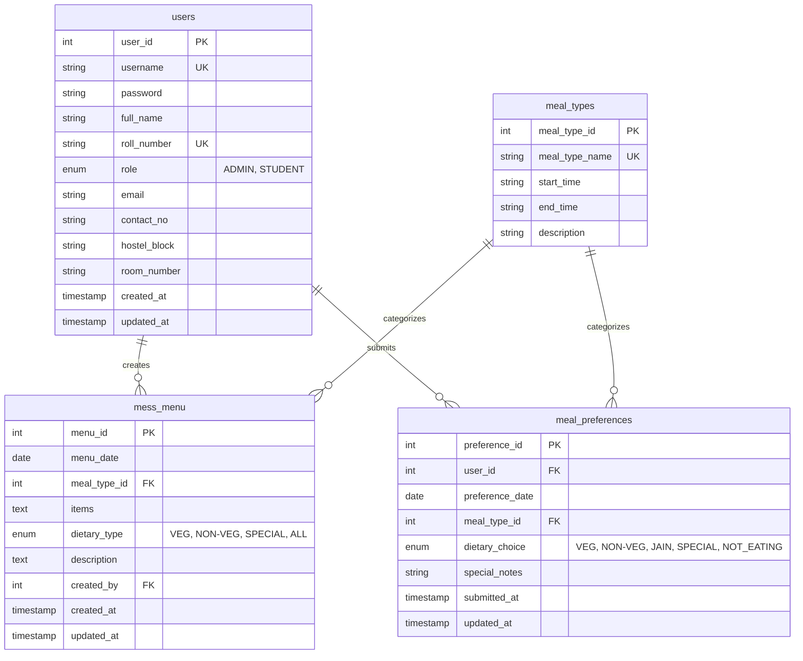

# Database Design & Architecture Document
## Mess Menu & Meal Preference Management System
**Poornima Institute of Engineering & Technology, Jaipur**  
**Minor Project NSP (Session 2026-27)**

---

### Student Information
- **Student Name:** JITWAR JHA
- **Roll Number:** PIET25CR022
- **Section:** 3CSD
- **Semester:** III

---

### 1. Database Architecture Overview
- **Database Engine:** MySQL 8.0 / InnoDB Storage Engine
- **Database Name:** `mess_management_db`
- **Character Set:** `utf8mb4`
- **Collation:** `utf8mb4_unicode_ci`

---

### 2. Entity Relationship (ER) Diagram



---

### 3. Data Dictionary & Table Schemas

#### 3.1 Table: `users`
Stores student residents and mess administrative personnel.

| Column Name | Data Type | Constraints | Description |
| :--- | :--- | :--- | :--- |
| `user_id` | `INT` | `AUTO_INCREMENT`, `PRIMARY KEY` | Unique identifier for each user |
| `username` | `VARCHAR(50)` | `NOT NULL`, `UNIQUE` | Unique login username |
| `password` | `VARCHAR(255)` | `NOT NULL` | Account password |
| `full_name` | `VARCHAR(100)` | `NOT NULL` | Full name of student/admin |
| `roll_number` | `VARCHAR(50)` | `UNIQUE`, `NULL` | Student college roll number |
| `role` | `ENUM('ADMIN','STUDENT')` | `NOT NULL`, Default `'STUDENT'` | Access level |
| `email` | `VARCHAR(100)` | `NULL` | Contact email address |
| `contact_no` | `VARCHAR(20)` | `NULL` | Mobile phone number |
| `hostel_block` | `VARCHAR(30)` | Default `'Block-A'` | Assigned hostel building |
| `room_number` | `VARCHAR(20)` | Default `'101'` | Assigned room number |
| `created_at` | `TIMESTAMP` | Default `CURRENT_TIMESTAMP` | Account creation timestamp |
| `updated_at` | `TIMESTAMP` | On Update `CURRENT_TIMESTAMP` | Last profile update timestamp |

**Indexes:**
- `idx_user_role` ON `role`
- `idx_user_username` ON `username`
- `idx_user_roll` ON `roll_number`

---

#### 3.2 Table: `meal_types`
Master lookup table storing standard mess meal sessions.

| Column Name | Data Type | Constraints | Description |
| :--- | :--- | :--- | :--- |
| `meal_type_id` | `INT` | `AUTO_INCREMENT`, `PRIMARY KEY` | Unique ID for meal type |
| `meal_type_name` | `VARCHAR(30)` | `NOT NULL`, `UNIQUE` | Breakfast, Lunch, Snacks, Dinner |
| `start_time` | `VARCHAR(20)` | `NOT NULL` | Serving start time (e.g. 07:30 AM) |
| `end_time` | `VARCHAR(20)` | `NOT NULL` | Serving end time (e.g. 09:30 AM) |
| `description` | `VARCHAR(255)` | `NULL` | Session details & notes |

---

#### 3.3 Table: `mess_menu`
Stores food items scheduled for each date and meal session.

| Column Name | Data Type | Constraints | Description |
| :--- | :--- | :--- | :--- |
| `menu_id` | `INT` | `AUTO_INCREMENT`, `PRIMARY KEY` | Unique identifier for menu entry |
| `menu_date` | `DATE` | `NOT NULL` | Calendar date for scheduled menu |
| `meal_type_id` | `INT` | `NOT NULL`, `FOREIGN KEY` | References `meal_types(meal_type_id)` |
| `items` | `TEXT` | `NOT NULL` | Comma-separated or detailed food dishes |
| `dietary_type` | `ENUM('VEG','NON-VEG','SPECIAL','ALL')` | `NOT NULL`, Default `'VEG'` | Primary dietary classification |
| `description` | `TEXT` | `NULL` | Chef's notes or special dessert highlights |
| `created_by` | `INT` | `NULL`, `FOREIGN KEY` | References `users(user_id)` |
| `created_at` | `TIMESTAMP` | Default `CURRENT_TIMESTAMP` | Record creation timestamp |
| `updated_at` | `TIMESTAMP` | On Update `CURRENT_TIMESTAMP` | Last updated timestamp |

**Constraints & Indexes:**
- `CONSTRAINT fk_menu_meal_type FOREIGN KEY (meal_type_id) REFERENCES meal_types(meal_type_id) ON DELETE CASCADE`
- `CONSTRAINT fk_menu_creator FOREIGN KEY (created_by) REFERENCES users(user_id) ON DELETE SET NULL`
- `CONSTRAINT uq_menu_date_meal UNIQUE (menu_date, meal_type_id)`
- `INDEX idx_menu_date (menu_date)`

---

#### 3.4 Table: `meal_preferences`
Stores resident daily dietary selections and special requests.

| Column Name | Data Type | Constraints | Description |
| :--- | :--- | :--- | :--- |
| `preference_id` | `INT` | `AUTO_INCREMENT`, `PRIMARY KEY` | Unique preference entry identifier |
| `user_id` | `INT` | `NOT NULL`, `FOREIGN KEY` | References `users(user_id)` |
| `preference_date` | `DATE` | `NOT NULL` | Date for which preference is chosen |
| `meal_type_id` | `INT` | `NOT NULL`, `FOREIGN KEY` | References `meal_types(meal_type_id)` |
| `dietary_choice` | `ENUM('VEG','NON-VEG','JAIN','SPECIAL','NOT_EATING')` | `NOT NULL`, Default `'VEG'` | Student's dining selection |
| `special_notes` | `VARCHAR(255)` | `NULL` | Student instruction (e.g. coffee only) |
| `submitted_at` | `TIMESTAMP` | Default `CURRENT_TIMESTAMP` | Preference submission timestamp |
| `updated_at` | `TIMESTAMP` | On Update `CURRENT_TIMESTAMP` | Last modified timestamp |

**Constraints & Indexes:**
- `CONSTRAINT fk_pref_user FOREIGN KEY (user_id) REFERENCES users(user_id) ON DELETE CASCADE`
- `CONSTRAINT fk_pref_meal_type FOREIGN KEY (meal_type_id) REFERENCES meal_types(meal_type_id) ON DELETE CASCADE`
- `CONSTRAINT uq_user_date_meal UNIQUE (user_id, preference_date, meal_type_id)`
- `INDEX idx_pref_date (preference_date)`
- `INDEX idx_pref_user (user_id)`

---

### 4. Normalization Analysis

1. **First Normal Form (1NF):**
   - All attributes contain atomic values.
   - Primary keys uniquely identify every record in all tables.
   - Repeating groups are eliminated by separating meal types into lookup tables.
2. **Second Normal Form (2NF):**
   - Tables are in 1NF.
   - All non-key attributes are fully functionally dependent on the entire primary key (no partial dependencies).
3. **Third Normal Form (3NF):**
   - Tables are in 2NF.
   - Transitive dependencies are removed. For instance, meal timing and name belong in `meal_types` rather than duplicating across `mess_menu` and `meal_preferences`.

---

### 5. Core SQL Queries Used in JDBC

#### 5.1 User Authentication
```sql
SELECT * FROM users WHERE username = ? AND password = ?;
```

#### 5.2 Dynamic Mess Menu Search
```sql
SELECT m.*, mt.meal_type_name, u.full_name AS creator_name 
FROM mess_menu m 
JOIN meal_types mt ON m.meal_type_id = mt.meal_type_id 
LEFT JOIN users u ON m.created_by = u.user_id 
WHERE (m.items LIKE ? OR m.description LIKE ?) 
  AND m.menu_date = ? 
  AND m.meal_type_id = ? 
ORDER BY m.menu_date DESC, m.meal_type_id ASC;
```

#### 5.3 Daily Headcount Aggregation Query (Kitchen Slip)
```sql
SELECT mt.meal_type_id, mt.meal_type_name,
       COUNT(p.preference_id) AS total_count,
       SUM(CASE WHEN p.dietary_choice = 'VEG' THEN 1 ELSE 0 END) AS veg_count,
       SUM(CASE WHEN p.dietary_choice = 'NON-VEG' THEN 1 ELSE 0 END) AS non_veg_count,
       SUM(CASE WHEN p.dietary_choice = 'JAIN' THEN 1 ELSE 0 END) AS jain_count,
       SUM(CASE WHEN p.dietary_choice = 'SPECIAL' THEN 1 ELSE 0 END) AS special_count,
       SUM(CASE WHEN p.dietary_choice = 'NOT_EATING' THEN 1 ELSE 0 END) AS not_eating_count
FROM meal_types mt
LEFT JOIN meal_preferences p ON mt.meal_type_id = p.meal_type_id AND p.preference_date = ?
GROUP BY mt.meal_type_id, mt.meal_type_name
ORDER BY mt.meal_type_id ASC;
```
