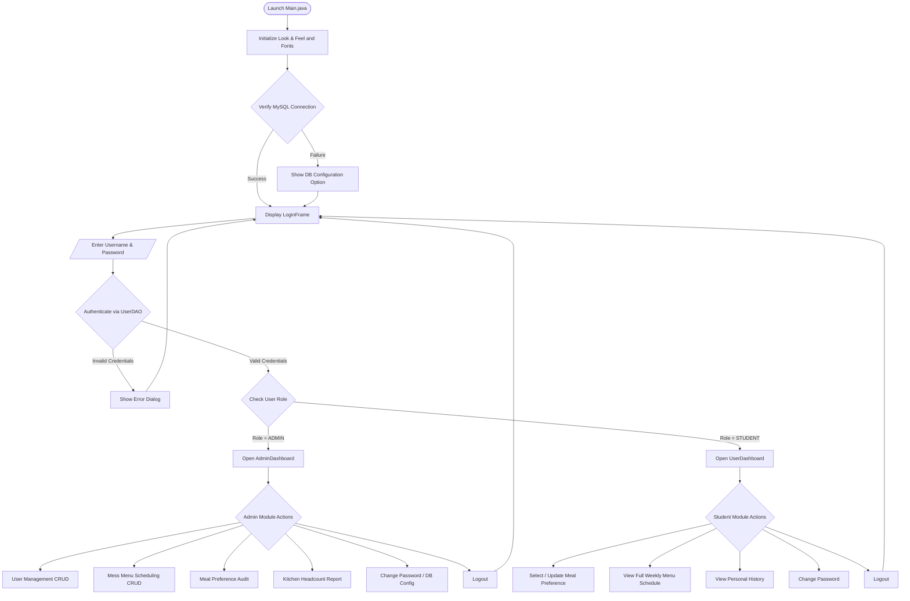
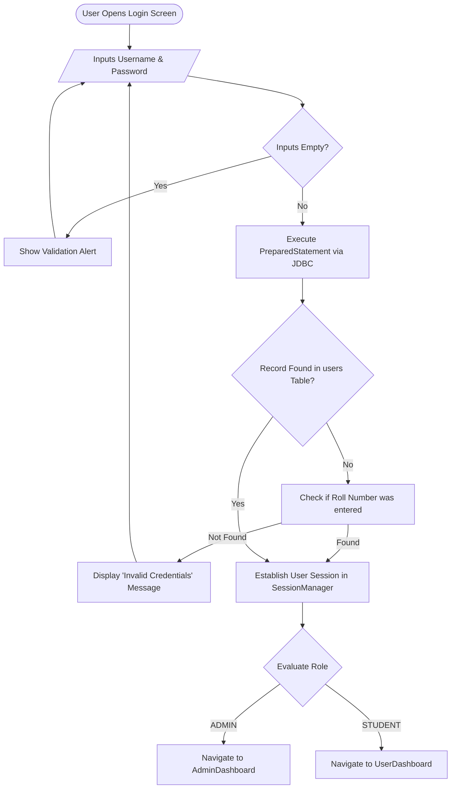
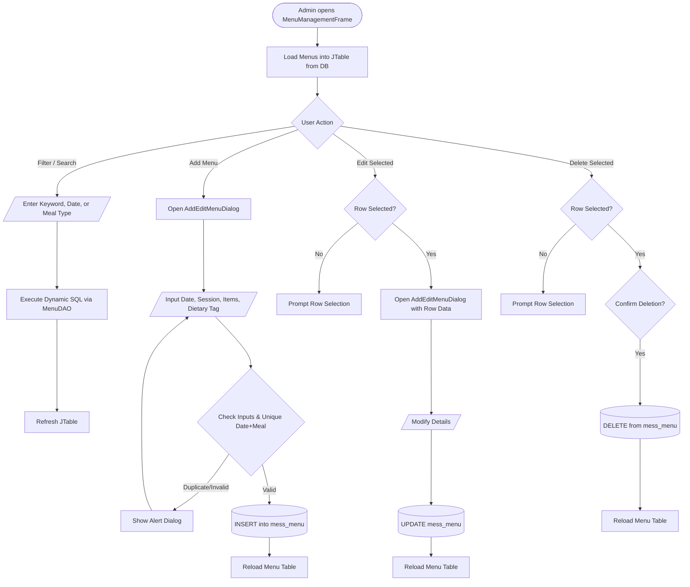
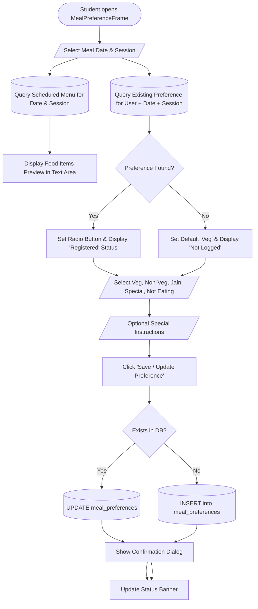
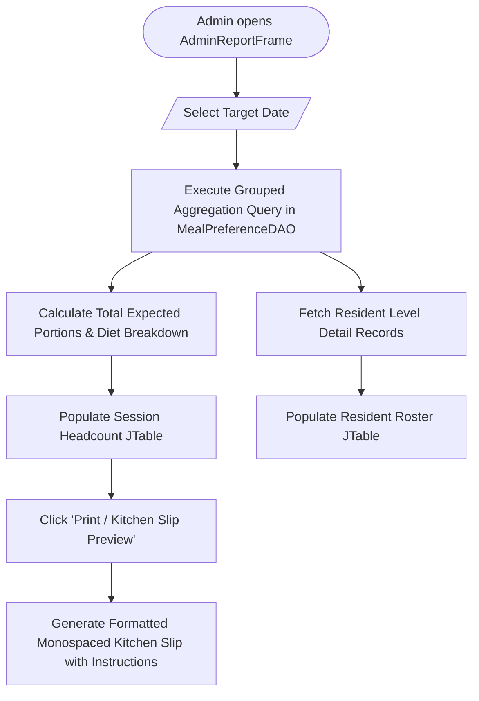

# System Architecture, Flowcharts & Diagrams
## Mess Menu & Meal Preference Management System
**Poornima Institute of Engineering & Technology, Jaipur**  
**Minor Project NSP (Session 2026-27)**

---

### Student Information
- **Student Name:** JITWAR JHA
- **Roll Number:** PIET25CR022
- **Section:** 3CSD
- **Semester:** III

---

### 1. Overall System Execution Flow

---

### 2. Login & Authentication Flow

---

### 3. Mess Menu Management (CRUD) Flow

---

### 4. Student Meal Preference Submission Flow

---

### 5. Kitchen Headcount & Report Aggregation Flow

