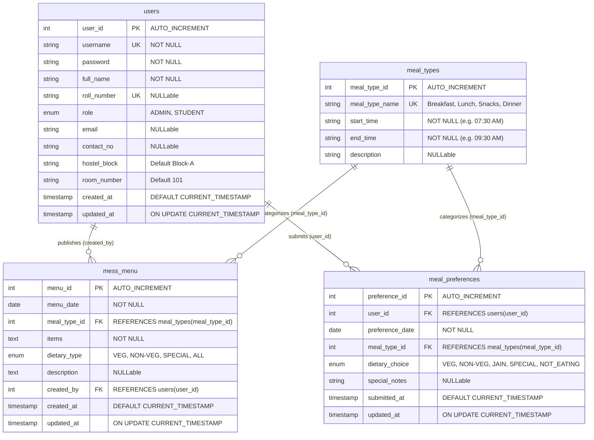

# ENTITY RELATIONSHIP (ER) DIAGRAM
## Mess Menu & Meal Preference Management System
**Poornima Institute of Engineering & Technology, Jaipur**  
**Department of Computer Science & Engineering | Mid Term – I Evaluation**

---

### Student Information
- **Student Name:** JITWAR JHA
- **Roll Number:** PIET25CR022
- **Section / Semester:** 3CSD / III Semester

---

### 1. Entity Relationship (ER) Diagram (Mermaid Notation)

---

### 2. Relationship Cardinality & Business Rules

1. **`users` to `mess_menu` (1 : N):**
   - One Administrator can publish multiple mess menus over time.
   - Each menu is associated with at most one creating admin (`created_by`).
   - Referential rule: `ON DELETE SET NULL` (historical menus are retained even if an admin account is removed).

2. **`users` to `meal_preferences` (1 : N):**
   - One student can submit multiple meal preferences across different dates and sessions.
   - Each preference belongs to exactly one student (`user_id`).
   - Referential rule: `ON DELETE CASCADE` (if a student account is deleted, their preference records are safely cleaned).

3. **`meal_types` to `mess_menu` (1 : N):**
   - One meal session type (e.g., *Lunch*) can be scheduled across many dates.
   - Each menu record is tied to exactly one meal session (`meal_type_id`).
   - Referential rule: `ON DELETE CASCADE`.

4. **`meal_types` to `meal_preferences` (1 : N):**
   - One meal session type is referenced across many student dietary submissions.
   - Each preference entry specifies exactly one meal session.
   - Referential rule: `ON DELETE CASCADE`.

5. **Composite Unique Constraints:**
   - In `mess_menu`: `UNIQUE (menu_date, meal_type_id)` ensures that no more than one official menu is scheduled for a given meal session on any date.
   - In `meal_preferences`: `UNIQUE (user_id, preference_date, meal_type_id)` guarantees that a student can only have one active preference per meal session on any date.
