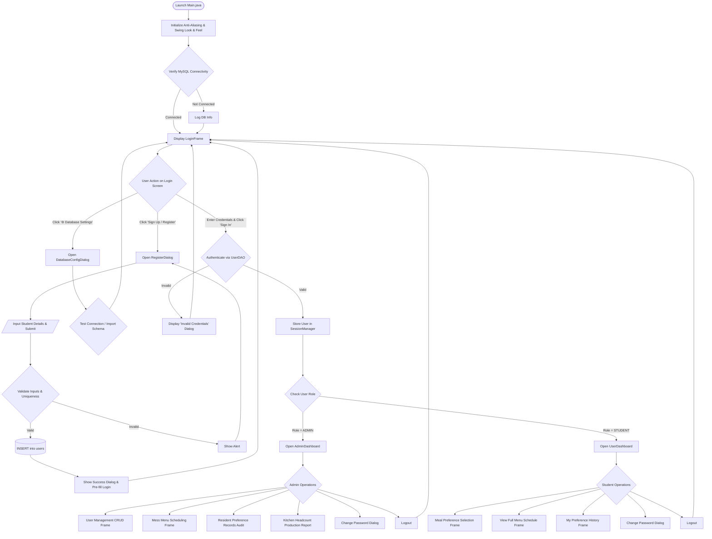
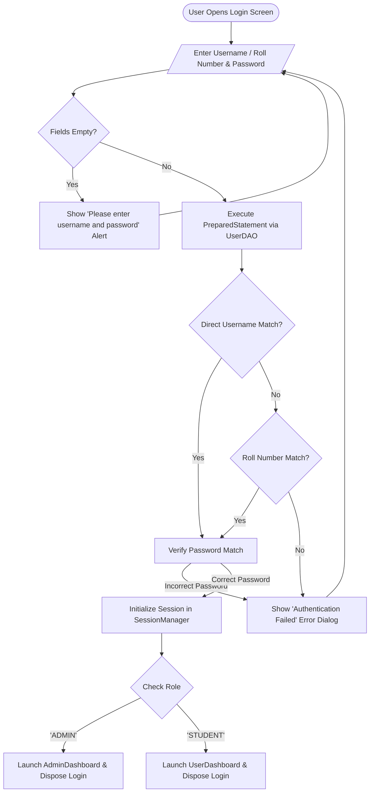
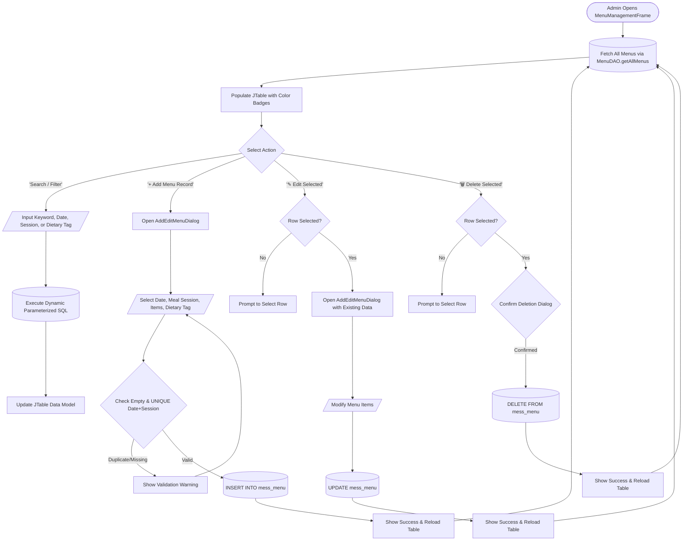
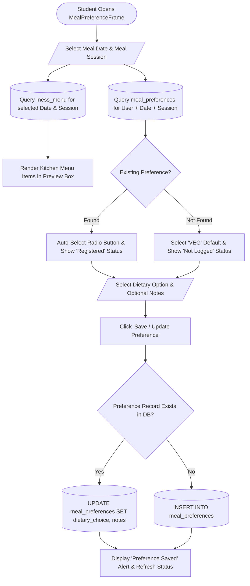
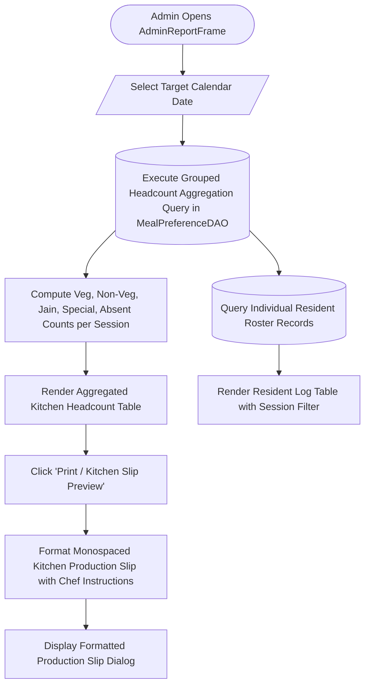

# SYSTEM FLOWCHARTS & PROCESS MODELS
## Mess Menu & Meal Preference Management System
**Poornima Institute of Engineering & Technology, Jaipur**  
**Department of Computer Science & Engineering | Mid Term – I Evaluation**

---

### Student Information
- **Student Name:** JITWAR JHA
- **Roll Number:** PIET25CR022
- **Section / Semester:** 3CSD / III Semester

---

### Flowchart 1: Overall System Execution Flow

---

### Flowchart 2: User Authentication & Role-Based Redirection

---

### Flowchart 3: Mess Menu Management (CRUD Flow)

---

### Flowchart 4: Student Meal Preference & Smart Upsert Flow

---

### Flowchart 5: Kitchen Headcount & Production Slip Generation Flow

